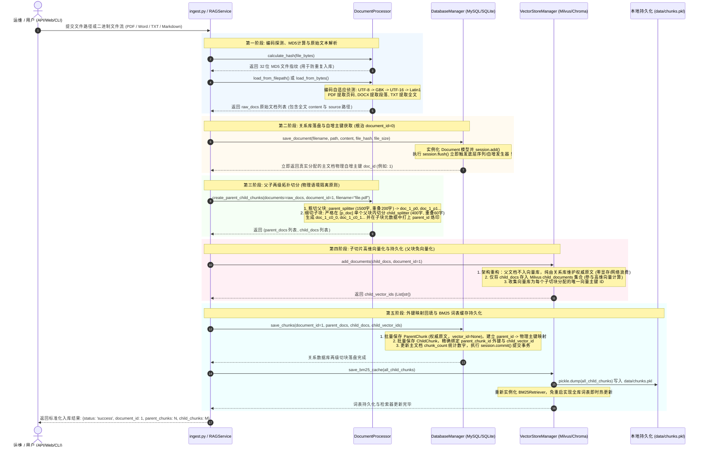

# Enterprise-CRAG: 企业级自校正多路混合检索问答系统
> **基于 LangGraph 状态图 · 父子文档拓扑分块 (Parent-Child) · Dense 向量与 BM25 混合初筛 · Cross-Encoder 语义精排 · 外部联网补偿 (Corrective RAG) · 事实反思核验回路**

[](https://www.python.org/downloads/)
[](https://github.com/langchain-ai/langgraph)
[](https://milvus.io)
[](https://fastapi.tiangolo.com)
[](https://streamlit.io)
[](tests/)

---

## 📖 项目全景简介

**Enterprise-CRAG** 是一个面向企业私有知识库问答场景的高可用、工业级自校正检索增强生成系统（Corrective RAG）。

针对传统线性 Naive RAG 普遍存在的四大生产级痛点：
1. **切分粒度矛盾**：切块过小（300字）匹配准但语义碎片化，切块过大（1500字）包含多主题导致向量语义稀释；
2. **专有名词失真**：纯密集向量（Dense）检索对企业内部特定型号、工号、缩写代号不敏感，容易产生语义漂移；
3. **知识盲区硬编造**：私有库未覆盖的问题强行拼接不相关段落，导致大模型产生严重业务幻觉；
4. **单体脚本缺乏工程韧性**：缺乏关系数据库生命周期管理、无自增外键时序保障、索引句柄容易陈旧锁死、单点服务缺乏容灾降级。

本项目进行了系统性架构重构与算法创新：采用 **LangGraph** 构建包含自反思回路的状态图引擎；自研**两级父子拓扑分块算法**与 **Dense 向量 + BM25 稀疏多路初筛召回 + Cross-Encoder 深度重排**；设计 **MySQL ↔ SQLite 自动无缝降级** 与 **RAGService 统一业务服务中枢**；构建包含 **FastAPI 微服务、Streamlit 智能看板（带 URL 会话状态同步）与 CLI 交互终端** 的三端交付体系。

---

## 🏗️ 系统全景架构图与核心流程图矩阵

### 1. 全局智能问答运行时状态机流图 (End-to-End CRAG Runtime StateFlow)

```mermaid
flowchart TD
    Client["👤 客户端提问<br>(Web / REST API / CLI)"] --> RAGServiceEntry["🏢 RAGService.chat()<br>1. 校验/分配 session_id<br>2. 关系库提取最近 4 轮滑动窗口历史<br>3. 组装初始全局状态 GraphState"]

    subgraph StateBox["全局强类型契约: GraphState"]
        StateVars["• question: 用户提问<br>• session_id: 会话UUID<br>• chat_history: 多轮滑动历史<br>• parent_context: 逆向展开父块文本<br>• sources: 引用片段元数据字典<br>• web_search_required: 联网补偿开关<br>• web_context: 外部搜索抓取摘要<br>• generation: 模型当前生成文本<br>• retry_count: 反思重试已累计次数<br>• hallucination_detected: 幻觉检测标志<br>• execution_steps: 节点流转轨迹审计"]
    end
    RAGServiceEntry -.-> StateBox

    subgraph Stage1["第一阶段: 两阶段混合检索与父块逆向拓扑展开 (带三级容灾自愈)"]
        RAGServiceEntry --> RetrieveNode["🔍 节点 1: retrieve_node<br>输入: question, filter_doc_ids"]
        
        RetrieveNode --> HybridSearch["调用 VectorStoreManager.hybrid_search_child_chunks()"]
        HybridSearch --> CondFilter{"是否有限定文档?"}
        CondFilter -- "是" --> DenseOnly["单路高维向量初筛 (Dense cand_k=16)<br>Milvus expr: document_id in [...]"]
        CondFilter -- "否" --> EnsembleRRF["Dense 向量 + BM25 稀疏初筛<br>EnsembleRetriever (RRF 融合权重 0.5:0.5)<br>召回 cand_k (16) 个候选子块"]
        
        DenseOnly --> RerankStep["🎯 Cross-Encoder 深度语义精排<br>bge-reranker 交叉注意力打分，截取最优 Top-4"]
        EnsembleRRF --> RerankStep
        
        RerankStep --> CheckStale{"底层连接/句柄是否陈旧?"}
        
        CheckStale -- "是 (异常捕获)" --> ReloadAction["🔄 触发 reload()<br>重置 Milvus/Chroma 客户端句柄并重试"]
        ReloadAction --> RetryFailed{"重试仍失败?"}
        RetryFailed -- "是 (终极兜底)" --> BM25Fallback["🛡️ 纯内存 BM25 稀疏检索兜底接管<br>从 chunks.pkl 倒排索引检索候选并精排"]
        RetryFailed -- "否" --> ChildDocsReady["✅ 获得 Top-4 高精细度子块集合"]
        CheckStale -- "否 (正常)" --> ChildDocsReady
        BM25Fallback --> ChildDocsReady

        ChildDocsReady --> ExpandStep["📂 调用 expand_parent_documents(child_docs)<br>提取 parent_id 列表，使用哈希集合保序去重"]
        ExpandStep --> DBCheck{"优先从关系库毫秒级反查?"}
        DBCheck -- "成功 (关系库命中)" --> FetchParentsDB["⚡ DatabaseManager.get_parent_chunks_by_parent_ids()<br>走关系库唯一业务索引直接批量查出"]
        DBCheck -- "失败/未命中/未注入" --> ChildContentFallback["⚠️ 降级采用命中子块的正文作为上下文<br>(零外部假向量依赖，下游链路绝不中断)"]
        
        FetchParentsDB --> CheckEmptyParent{"查出的父块列表是否为空?"}
        CheckEmptyParent -- "是 (极端故障)" --> ChildContentFallback
        CheckEmptyParent -- "否 (正常)" --> ParentDocsReady["✅ 获得 1500 字完整连贯父块段落"]
        ChildContentFallback --> ContextReady["组装 parent_context 与 sources 溯源抽屉<br>更新 execution_steps += ['retrieve']"]
        ParentDocsReady --> ContextReady
    end

    subgraph Stage2["第二阶段: 文档评分与 Corrective 联网纠错补偿"]
        ContextReady --> GradeNode["📊 节点 2: grade_documents_node<br>输入: question, parent_context[:3000]"]
        
        GradeNode --> CheckContextEmpty{"本地上下文是否为空?"}
        CheckContextEmpty -- "是 (无匹配文档)" --> MarkWebTrue["标记 web_search_required = True"]
        CheckContextEmpty -- "否" --> GradeExec["结构化评估与双层防御"]
        
        GradeExec --> PydanticGrade["第一层: with_structured_output(GradeResult)<br>严格强制返回 JSON: is_relevant, reasoning"]
        PydanticGrade --> GradeException{"大模型工具调用异常?"}
        GradeException -- "是" --> TextGradeFallback["第二层: 回退普通文本请求<br>结合关键词正则模糊匹配 ('true'/'相关'/'yes')"]
        GradeException -- "否" --> EvalDone["得出相关度评估结论"]
        TextGradeFallback --> EvalDone
        
        EvalDone --> Router1{"🚦 条件路由 1: decide_to_generate<br>state['web_search_required'] 是否为 True?"}
        MarkWebTrue --> Router1
        
        Router1 -- "True (私有知识不足)" --> WebSearchNode["🌐 节点 3: web_search_node<br>调用 DuckDuckGoSearchRun 发起实时网络检索<br>抓取公网权威摘要注入 web_context"]
        Router1 -- "False (私有知识充足)" --> GenerateNode
        WebSearchNode --> GenerateNode
    end

    subgraph Stage3["第三阶段: 回答综合生成、事实反思核验与安全熔断"]
        GenerateNode["✍️ 节点 4: generate_node<br>输入: chat_history + parent_context + web_context + question<br>LCEL 管道调用主力大模型 (temperature=0.3)<br>按结构化分点排版生成条理化完整回答"]
        
        GenerateNode --> HallucinationNode["🛡️ 节点 5: hallucination_check_node<br>第三方独立事实质检员<br>核查 generation 是否超出 (parent_context + web_context)"]
        
        HallucinationNode --> PydanticCheck["第一层: with_structured_output(HallucinationResult)<br>返回 has_hallucination: bool, reasoning: str"]
        PydanticCheck --> CheckError{"解析异常?"}
        CheckError -- "是" --> TextCheckFallback["第二层: 文本请求与关键词匹配降级"]
        CheckError -- "否" --> CheckDone["完成一致性核查判定"]
        TextCheckFallback --> CheckDone
        
        CheckDone --> UpdateRetry["计算重试计数:<br>若 has_hallucination=True 则 retry_count + 1"]
        UpdateRetry --> Router2{"🚦 条件路由 2: decide_after_check<br>存在幻觉 且 retry_count < MAX_RETRIES (3)?"}
        
        Router2 -- "是 (存在事实捏造 且 未达上限)" --> RegenerateLoop["🔁 打回重新反思生成<br>(将状态路由回 generate_node)"]
        RegenerateLoop --> GenerateNode
        
        Router2 -- "否 (无幻觉 放行)" --> GraphEnd["🏁 状态图顺利收敛结束 [END]"]
        Router2 -- "否 (达到 3 次上限 触发熔断)" --> CircuitBreaker["⚠️ 触发 MAX_RETRIES 安全熔断<br>强制终止重试循环，交付当前最佳生成结果 [END]"]
        CircuitBreaker --> GraphEnd
    end

    subgraph Stage4["第四阶段: 双库事务持久化与三端交付"]
        GraphEnd --> SaveHistory["💾 DatabaseManager.save_chat_history()<br>1. 原子写入 chat_history 数据表<br>2. 记录 session_id、问答正文、document_ids 与 sources JSON<br>3. 更新会话首问智能提炼标题 (22字优雅截断)"]
        SaveHistory --> DeliverResponse["🚀 交付标准化响应结构 ChatResponse<br>• Streamlit: 真流式打字机渲染、CRAG 状态灯、引用抽屉、URL 同步<br>• FastAPI: 遵循 RESTful 规范输出 JSON 响应载荷<br>• CLI: 终端彩色打印节点流转轨迹与最终结果"]
    end
```



---

### 2. 知识库五阶段解析、切分与双库持久化流水线时序图 (Ingestion Pipeline)



---

### 3. 全系统多层容灾降级与索引自愈决策树 (Failover Decision Tree)

```mermaid
flowchart TD
    subgraph StorageFailover["1. 关系数据库 - 双模自适应动态探针降级"]
        StartDB["系统初始化 DatabaseManager.init_database"] --> CheckCfg{"配置 DB_TYPE 是否为 mysql"}
        CheckCfg -- "否" --> SQLiteDirect["激活本地 SQLite 存储<br>路径: data/rag_metadata.db"]
        CheckCfg -- "是" --> TryMySQL["配置 MySQL 连接池<br>pool_pre_ping=True, pool_recycle=3600"]
        TryMySQL --> ProbeConnect["发送真实网络探针测试: engine.connect"]
        ProbeConnect --> MySQLSuccess{"探针连通是否成功"}
        MySQLSuccess -- "连接成功" --> InitMySQL["✅ 激活 MySQL 引擎 (utf8mb4)<br>执行 _migrate_schema 自动补充缺失字段"]
        MySQLSuccess -- "连接失败" --> CatchWarn["⚠️ 捕获 OperationalError 异常并记录日志"]
        CatchWarn --> AutoFallbackSQLite["🔄 自动无缝降级至本地 SQLite 引擎<br>Base.metadata.create_all 同步全套表结构<br>零外部依赖，系统绝不中断崩溃"]
    end

    subgraph VectorFailover["2. 向量数据库与混合检索 - 三级容灾自愈网络"]
        QueryIn["执行混合检索 query"] --> ExecHybrid["一级防护: 正常调用 Dense 和 BM25 初筛 (cand_k=16)"]
        ExecHybrid --> HybridOk{"执行是否抛出异常"}
        HybridOk -- "运行正常" --> CrossRerank["调用 Cross-Encoder 重排截取 Top-4"]
        HybridOk -- "连接超时或句柄陈旧" --> CatchStale["⚠️ 捕获异常，记录告警日志"]
        CatchStale --> ExecReload["二级自愈: 立即触发 reload 热重载<br>重新初始化客户端连接与集合句柄，重新加载 BM25 词表"]
        ExecReload --> RetrySearch["执行第二次检索重试"]
        RetrySearch --> RetryOk{"重试是否成功"}
        RetryOk -- "重试成功" --> CrossRerank
        RetryOk -- "重试失败" --> PureBM25["三级终极兜底: 激活纯内存 BM25 稀疏检索<br>直接从本地 chunks.pkl 倒排索引检索候选片段<br>切断向量库依赖，保底可用"]
        PureBM25 --> CrossRerank
        CrossRerank --> ReturnDocs["✅ 正常返回精排去重后的 Top-K 子块"]
    end

    subgraph ParentFailover["3. 父块逆向拓扑展开 - 异常兜底机制"]
        ChildIn["输入检索命中的子块 child_docs"] --> TryDBParent["优先策略: 从关系数据库按 parent_id 唯一索引批量反查"]
        TryDBParent --> DBParentOk{"是否全部反查成功"}
        DBParentOk -- "命中" --> ReturnParents["✅ 返回完整 1500 字大父块段落"]
        DBParentOk -- "反查异常/未注入" --> ChildTextFallback["⚠️ 终极保底: parent_docs 安全回退使用 child_docs<br>直接提取命中的 400 字子块正文送入大模型<br>语境稍短但保障系统平稳运行，零外部伪向量依赖"]
        ChildTextFallback --> ReturnParents
    end
```



---

## 🌟 核心技术亮点与架构设计

### 1. 父子两级拓扑分块机制 (Parent-Child Chunking)
- **痛点破解**：破解长久困扰 RAG 工程的“切分粒度悖论”（The Chunk Dilemma）。
- **切分方案**：整篇文档粗粒度切分为 **1500 字符父块**（保持条文与段落语义完整）；在单个父块物理边界内细粒度切分为 **400 字符子块**（确保子块物理语境绝不跨越父块边界）。
- **两级检索映射**：向量库与 BM25 **仅对子块建立索引**保证高语义聚焦与高召回率；检索命中后，通过元数据中的 `parent_id` 毫秒级逆向回溯提取对应的完整父块，合并拼装送入 LLM，“用小块精准召回，用大块饱满作答”。

### 2. 两阶段混合检索：Dense + Sparse 混合初筛 与 Cross-Encoder 语义精排
- **初筛阶段 (Dense + Sparse)**：密集向量（Dense）擅长泛化同义词意图，稀疏词频（BM25）擅长精确匹配专有名词、产品型号、规程编号与缩写。采用 `EnsembleRetriever` 进行加权融合初筛候选池（默认初筛 `cand_k=16`，权重比率 `0.5 : 0.5`）；支持离线序列化缓存 `chunks.pkl`，避免冷启动重建倒排索引。
- **精排阶段 (Cross-Encoder)**：接入轻量级重排模型（`bge-reranker-base`），对初筛候选切片与用户提问进行深度注意力交叉打分（Query-Doc Cross Attention），有效剔除弱相关切片噪声，精排截取最优 Top-4 送入后续环节；支持无缝降级与本地离线部署。

### 3. Corrective RAG (CRAG) 外部实时知识补偿
- **裁判评估节点**：检索完成后并不盲目送入大模型，而是通过独立的 `grade_documents` 节点对召回上下文做相关度评分。
- **自动纠错路由**：当私有知识库缺失或相关度不合格时，条件边自动分支至 `web_search` 节点（调用 DuckDuckGo 外部引擎），动态弥补私有文档盲区，杜绝模型面对未知问题硬编乱造。

### 4. Self-Reflection 事实反思回路与安全熔断机制
- **独立质检员**：回答生成后，进入 `hallucination_check` 节点核实回答是否超出参考资料范围。
- **反思重思闭环**：一旦发现捏造事实，条件边将状态打回 `generate` 节点重新反思生成。
- **工业级安全熔断**：在 `GraphState` 中严格维护 `retry_count` 字段，当重试次数达到 `MAX_RETRIES`（默认 3 次）时强制终止循环并安全交付，彻底杜绝无限递归耗尽 Token。

### 5. 双库原子协同与零外部依赖无缝降级
- **四表拓扑结构**：SQLAlchemy ORM 管理 `documents`、`parent_chunks`、`child_chunks`、`chat_history` 四表。
- **根治 `document_id=0` 缺陷与单集合架构重构**：采用两阶段入库流水线，先插入主文档并通过 `session.flush()` 立即获取底层分配的真实自增 ID；向量库废除父文档伪向量化，仅子块入库建立索引（`vector_id` 构筑双库双向溯源桥梁），父块权威大段落纯由关系库直接纳管，显存与网络开销骤降 50%。
- **高可用自动降级**：系统启动时通过连接探针优先连接企业级 MySQL；若未部署 MySQL 或网络中断，系统自动捕获并无缝降级为本地 SQLite（`data/rag_metadata.db`），零外部配置开箱即跑！

### 6. 多层索引热自愈与兜底容灾体系
- **句柄热重载 `reload()`**：针对多线程并发或外部脚本修改导致的向量库索引句柄陈旧、文件锁争用，系统自动刷新重置客户端并安全重试。
- **三层容灾降级网**：向量检索异常时自动启用本地 BM25 稀疏检索兜底；若极端情况下未查出父块，自动降级采用子块正文作答，确保下游接口永不报 500。

### 7. 统一服务层解耦与 ChatGPT 风格三端交互
- **RAGService 业务中枢**：统一封装入库、问答、多轮上下文、文档删除逻辑，解耦各表现层。
- **FastAPI 生产微服务 (`api.py`)**：严格遵循 RESTful 规范，提供 Swagger UI 在线调试、文件上传解析、健康探针与 CORS 跨域支持。
- **Streamlit 智能看板 (`app.py`)**：支持真流式打字机渲染、CRAG 状态灯实时点亮、引用证据抽屉，以及基于 URL Query 参数（`?session_id=`）的无刷新多会话状态恢复。

---

## 📁 项目工程目录结构

```
Enterprise-CRAG/
├── .env.example              # 环境变量配置模板
├── .env                      # 实际运行环境变量 (包含模型 Key、向量库地址等)
├── .gitignore                # Git 忽略配置文件
├── README.md                 # 项目详细说明文档 (本文件)
├── requirements.txt          # 核心依赖清单 (FastAPI, LangGraph, Milvus, Chroma 等)
│
├── config/                   # 集中配置管理中心
│   ├── __init__.py
│   └── config.py             # 统一配置类 Config (模型、路径、数据库、分块超参数)
│
├── core/                     # 基础设施与核心业务服务层
│   ├── __init__.py
│   ├── service.py            # RAGService 统一业务服务中枢 (面向 API/Web/CLI)
│   ├── models.py             # SQLAlchemy ORM 4 张数据表模型 (Document, ParentChunk, ChildChunk, ChatHistory)
│   ├── database.py           # DatabaseManager 双库协同、事务控制与 MySQL ↔ SQLite 降级
│   ├── document_processor.py # 多格式文档解析器与两级父子拓扑切分算法
│   └── vectorstore.py        # VectorStoreManager (Milvus:19530 / Chroma 双引擎、混合检索、热自愈)
│
├── agent/                    # LangGraph 状态图与智能体调度层
│   ├── __init__.py
│   ├── state.py              # 全局强类型状态定义 GraphState (TypedDict)
│   ├── prompts.py            # 集中提示词工程模板 (评分、回答生成、幻觉核验)
│   ├── nodes.py              # 5 个核心执行节点函数 (含 Pydantic 结构化约束与双层降级)
│   └── graph.py              # CRAG 状态图组装、条件路由与 MAX_RETRIES 安全熔断
│
├── data/                     # 知识库与本地存储目录
│   ├── docs/                 # 企业原始知识文档库 (TXT, PDF, Word, MD)
│   ├── chroma_db/            # Chroma 向量数据库本地持久化目录
│   ├── chunks.pkl            # BM25 稀疏检索词表序列化缓存
│   └── rag_metadata.db       # SQLite 兜底元数据文件
│
├── tests/                    # 自动化单元测试套件 (19 项测试全面覆盖)
│   ├── __init__.py
│   ├── test_database.py      # 数据库事务原子性、级联删除与会话历史测试
│   ├── test_graph.py         # 状态图路由分支、条件转移与熔断边界测试
│   ├── test_processor.py     # 文档解析、MD5 指纹与父子拓扑完整性断言
│   ├── test_service.py       # RAGService 业务中枢集成测试
│   └── test_vectorstore.py   # Milvus/Chroma 向量检索与 Cross-Encoder 重排测试
│
├── ingest.py                 # 离线批量知识库导入与预热构建脚本
├── api.py                    # FastAPI RESTful 生产微服务后端
├── app.py                    # Streamlit 现代化智能交互式工作台
└── main.py                   # 命令行 CLI 彩色交互终端
```

---

## 🚀 快速上手与运行指南

### 1. 开发环境就绪

推荐在 Python 3.10+ 环境下运行。若开发机已配置 Conda 环境（如 `rag`）：

```powershell
# 激活专属 conda 环境
conda activate rag

# 安装依赖清单
pip install -r requirements.txt
```

### 2. 环境变量配置

复制 `.env.example` 为 `.env`，并配置你的大模型 API Key（默认兼容阿里云通义千问 DashScope 兼容接口）：

```powershell
cp .env.example .env
```

核心配置项示例：
```env
# 大模型配置 (默认使用通义千问 DashScope 兼容接口)
OPENAI_API_KEY=sk-your-dashscope-api-key-here
OPENAI_BASE_URL=https://dashscope.aliyuncs.com/compatible-mode/v1
LLM_MODEL_NAME=qwen3.7-flash
EVAL_MODEL_NAME=qwen3.7-flash

# 向量数据库引擎配置 (默认 Milvus 19530 端口，可切换为 chroma)
VECTOR_STORE_TYPE=milvus
MILVUS_HOST=127.0.0.1
MILVUS_PORT=19530
MILVUS_URI=http://127.0.0.1:19530

# 嵌入模型提供商策略: 'local' (离线BGE) 或 'dashscope' (在线API)
EMBEDDING_PROVIDER=local
LOCAL_EMBEDDING_PATH=D:\llm\Local_model\BAAI\bge-large-zh-v1___5

# 关系型数据库配置 (连接失败自动无缝降级为 SQLite)
DB_TYPE=mysql
MYSQL_HOST=localhost
MYSQL_PORT=3306
MYSQL_USER=root
MYSQL_PASSWORD=root
MYSQL_DATABASE=rag

# 父子分块与检索参数
PARENT_CHUNK_SIZE=1500
PARENT_CHUNK_OVERLAP=200
CHILD_CHUNK_SIZE=400
CHILD_CHUNK_OVERLAP=60
RETRIEVAL_INITIAL_TOP_K=16
TOP_K=4
HYBRID_SEARCH_RATIO=0.5

# Reranker 交叉重排模型配置
RERANKER_ENABLED=true
RERANKER_MODEL_PATH=BAAI/bge-reranker-base

# CRAG 控制参数
MAX_RETRIES=3
ENABLE_WEB_SEARCH=true
```

> [!NOTE]
> **零依赖极速开箱**：若本机未安装 MySQL 或 Milvus 服务，系统具备全套自动降级机制 —— 关系库自动降级为嵌入式 SQLite，向量库可配置为本地 Chroma，无需安装任何外部复杂数据库即可秒级运行！
>
> 若在无外网连接或受限网络环境中，可将 `RERANKER_ENABLED` 设置为 `false` 跳过 Cross-Encoder 权重下载，系统将自动基于 RRF 初筛结果顺滑运行；或将 `RERANKER_MODEL_PATH` 指向预先下载好的本地模型目录。

### 3. 一键离线构建知识库 (Ingestion)

将企业私有文档（PDF / Word / TXT / Markdown）放入 `data/docs/` 目录，随后运行导入脚本：

```powershell
python ingest.py
```
执行过程将自动完成：原始文档加载 -> MD5 查重 -> 主文档入库（获取自增主键） -> 两级父子拓扑分块 -> 子块高维向量入库 -> 外键关联回填 -> BM25 词表缓存持久化。

---

### 4. 运行三种交付模式

#### 模式 A: 现代化交互式 Web 看板 (推荐)
```powershell
python -m streamlit run app.py
```
- 浏览器打开 `http://localhost:8501`；
- 支持企业文档拖拽上传与实时切分入库；
- 具备 ChatGPT 风格多会话管理与首问自动标题提炼；
- 具备真流式打字机渲染、CRAG 状态机指示灯与引用证据抽屉。

#### 模式 B: 生产级 RESTful 微服务 API
```powershell
python api.py
# 或使用 uvicorn 直接托管
uvicorn api:app --host 0.0.0.0 --port 8000 --reload
```
- 浏览器访问 `http://localhost:8000/docs` 体验标准 OpenAPI / Swagger 交互式文档；
- 提供 `/api/v1/chat` 智能问答、`/api/v1/documents/upload` 动态上传、`/health` 健康检查等接口。

#### 模式 C: 沉浸式命令行交互 (CLI)
```powershell
python main.py
```
- 终端彩色打印节点流转轨迹（`retrieve` -> `grade` -> `generate` -> `check`）；
- 支持 `/docs` 查询知识库列表、`/history` 查看当前对话历史。

---

## 🧪 自动化测试验证

系统编写了完备的自动化单元测试套件，全面覆盖数据底座、分块算法、状态图路由分支、向量检索与 Cross-Encoder 重排：

```powershell
pytest tests/ -v
```

测试执行结果：
```text
============================= test session starts =============================
tests/test_database.py::TestDatabaseManager::test_save_and_retrieve_document PASSED [  5%]
tests/test_database.py::TestDatabaseManager::test_save_chunks_cascade PASSED        [ 10%]
tests/test_database.py::TestDatabaseManager::test_chat_history PASSED               [ 15%]
tests/test_graph.py::TestDecideToGenerate::test_routes_to_web_search_when_docs_not_relevant PASSED [ 21%]
tests/test_graph.py::TestDecideToGenerate::test_routes_to_generate_when_docs_relevant PASSED       [ 26%]
tests/test_graph.py::TestDecideAfterCheck::test_ends_when_no_hallucination PASSED                   [ 31%]
tests/test_graph.py::TestDecideAfterCheck::test_regenerates_when_hallucination_detected_and_under_limit PASSED [ 36%]
tests/test_graph.py::TestDecideAfterCheck::test_ends_when_max_retries_reached PASSED               [ 42%]
tests/test_graph.py::TestDecideAfterCheck::test_ends_when_retry_count_exceeds_max PASSED           [ 47%]
tests/test_graph.py::TestDecideAfterCheck::test_regenerate_at_boundary_max_minus_one PASSED        [ 52%]
tests/test_processor.py::TestDocumentProcessor::test_calculate_hash PASSED                         [ 57%]
tests/test_processor.py::TestDocumentProcessor::test_create_parent_child_chunks PASSED             [ 63%]
tests/test_processor.py::TestDocumentProcessor::test_load_sample_documents PASSED                 [ 68%]
tests/test_service.py::TestRAGService::test_ingest_bytes_and_query PASSED                          [ 73%]
tests/test_service.py::TestRAGService::test_chat_pipeline_and_persistence PASSED                  [ 78%]
tests/test_service.py::TestRAGService::test_delete_document_integration PASSED                     [ 84%]
tests/test_vectorstore.py::TestVectorStoreManager::test_milvus_connection_and_single_collection PASSED [ 89%]
tests/test_vectorstore.py::TestVectorStoreManager::test_add_documents_and_expand_parent PASSED    [ 94%]
tests/test_vectorstore.py::TestVectorStoreManager::test_cross_encoder_rerank_logic PASSED        [100%]
============================= 19 passed in 18.25s =============================
```

> [!TIP]
> 测试套件内置环境自适应保护：当本地环境未启动独立 Milvus 容器服务时，测试框架将自动识别并优雅跳过外部网络联调项（保持 16 passed, 3 skipped，退出码 0），保障本地纯 SQLite/Chroma 环境开箱运行测试无阻碍。

---

## 📄 开源与商业友好协议

本项目遵循 MIT 开源许可协议，欢迎基于本项目进行学术研究、二次开发与企业级商业化落地。
